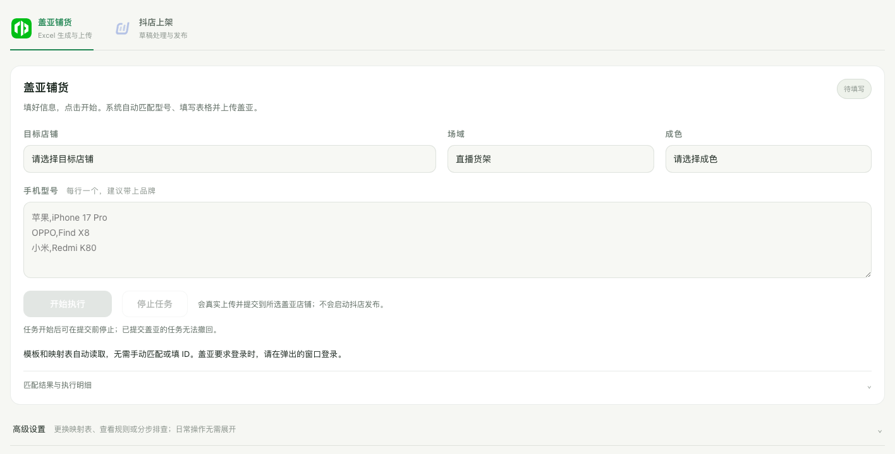
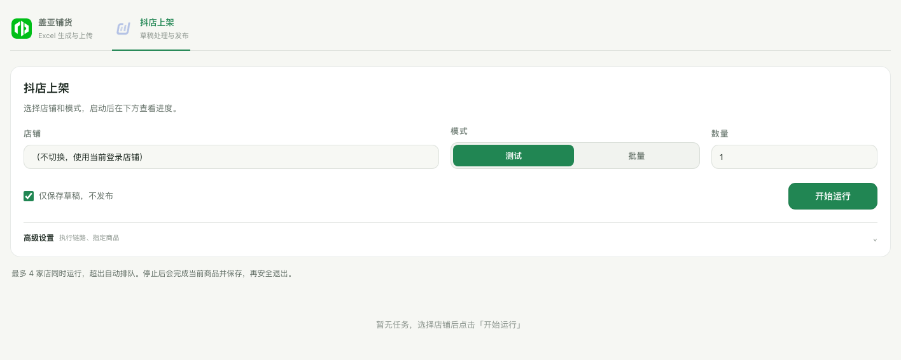

# 爱回收 · 智能运营平台

面向二手数码商品上架的运营面板，包含盖亚 Excel 铺货、抖店草稿处理、云盘素材匹配、并发队列及任务进度与报错查看。

## 前端设计预览

以「把每一次上新，稳稳接住」为首页主题，将品牌人物与日常运营操作放在同一个工作台中。

以下图片直接截取项目现有 HTML / CSS / JavaScript 页面，使用隔离的空数据预览，不是设计稿重绘。连接状态为模拟数据，不包含真实店铺、账号、商品或任务日志，也不代表生产任务已执行成功。

### 首页 · 品牌人物与双业务入口

浅暖灰背景、深墨绿色文字，以黄色人物作为视觉中心。首页仅保留「盖亚铺货」和「抖店上架」两个主要入口，用留白和细分割线组织页面。


### 盖亚铺货 · 填写信息，一键启动

店铺、场域、成色和手机型号集中填写；开始与停止按钮在同一区域。匹配明细与高级设置默认折叠，让日常操作先看到必要信息。



### 抖店上架 · 明确模式与安全边界

主操作区只保留店铺、测试 / 批量模式、数量与开始按钮。「仅保存草稿，不发布」默认勾选；执行链路和指定商品等选项收进高级设置，下方展示任务进度与队列。



### 界面实现

- **统一视觉**：共享颜色、字号、间距、按钮和表单样式；绿色用于主要操作与状态，黄色保留品牌识别。
- **人物交互**：由 `assets/mascot.js` 管理眼睛跟随、纸箱悬停与人物点击，复用透明 WebM 和同源人物图片；上方截图展示默认静态姿态。
- **渐进展示**：常用操作直接可见，低频设置与执行详情按需展开。
- **轻量前端**：原生 HTML、CSS、JavaScript，无需前端构建；任务进度使用 SSE，并以定时回查补齐状态。

<details>
<summary>重新生成这些界面截图</summary>

安装本页下方列出的 Python 依赖及 Playwright Chromium 后运行：

```sh
python tools/capture_readme_preview.py
```

脚本读取本地页面与 `assets/`，使用全新的无头浏览器和空任务数据，拦截所有页面网络请求，不启动面板服务、不读取登录会话、不连接店铺接口。输出在 `docs/images/`；系统字体可能随运行环境略有差异。

</details>

## 功能与边界

- **盖亚铺货**：填写店铺、成色和手机型号，匹配国行标品 ID，生成并回读校验 Excel，通过独立浏览器上传。提交前可停止；盖亚受理不等于逐行创建成功，也不等于抖店已发布。
- **抖店上架**：API 主链路，浏览器作为备用；支持单件验证、批量处理、仅保存草稿和真实发布。最多 4 家店并发，超出排队。
- **素材匹配**：飞书云盘优先、本地备选，处理主图、白底图、颜色规格图与成色详情图。
- **安全控制**：店铺隔离、提交回读、防重复启动、温和停止、任务日志与失败原因记录。

本仓库为源码与界面资源，不包含生产密钥、店铺登录会话、商品图库、业务导出表、运行日志或实时运营通知名单。

## 本地启动

当前使用 macOS / Python 3.9 的开发环境；跨平台部署仍需验证浏览器、路径及系统服务部分。建议使用独立虚拟环境。

```sh
python3 -m venv .venv
source .venv/bin/activate
python -m pip install -r requirements.txt
python -m playwright install chromium
cp env.example env.local
```

按实际授权填写 `env.local`。抖店需要应用凭证、店铺令牌和素材中心文件夹映射；飞书需要应用凭证及被授权的图库目录。示例不携带任何真实授权。

```sh
DP_HOST=127.0.0.1 python panel_server.py
```

访问 `http://127.0.0.1:8080`。仅查看界面不需要提交商品；不要在未完成授权与素材配置时启动真实任务。

## 生产配置注意

- `env.local`、`storage_state.json`、`chrome_user_data*`、`gaia_browser_data` 和 `panel_data` 属于部署环境私有数据，不提交 Git。
- 盖亚需要单独提供发品模板、价格映射表以及浏览器登录。文件可从本机下载目录读取，或由高级设置导入。
- 盖亚实际提交开关为 `config/gaia_execution.json`；即使只准备验证界面，也应核对该开关，不要误点击“开始执行”。
- 抖店示例默认关闭真实发布，且界面默认“仅保存草稿”。开启 `DP_API_MEDIA_PUBLISH_ENABLED=1` 前先完成单件草稿验证。
- 飞书报错通知使用部署时单独维护的 `config/operator_error_notifications.json`，不包含在公开源码中。
- 面板面向受控内网环境。不要未经访问控制、安全审查和身份验证就直接暴露到公网。
- 部分历史脚本包含开发机路径或特定测试店铺，请先阅读参数及执行边界，不要直接运行所有 `scripts/`、`tools/` 或测试文件。

## 目录

| 目录 / 文件 | 用途 |
| --- | --- |
| `panel.html`、`assets/` | 运营界面、人物资源及交互 |
| `panel_server.py` | 面板接口、任务调度和进度同步 |
| `panel_api_media_runner.py`、`panel_runner.py` | API 与浏览器执行器 |
| `app/gaia_listing/` | 盖亚匹配、生成、校验与批次状态 |
| `app/material_pipeline/` | 云盘素材目录与匹配 |
| `integrations/` | 抖店、盖亚浏览器、飞书接入 |
| `config/` | 非敏感规则及配置示例 |
| `tests/` | 离线测试与历史验证脚本 |
| `scripts/`、`tools/` | 运维、诊断及专项执行工具 |

## 已使用的离线回归命令

```sh
python -m unittest discover -s tests -p 'test_gaia*.py'
python -m unittest tests.test_panel_mascot_ui tests.test_panel_task_sync_ui tests.test_panel_server_security tests.test_panel_task_queue
node --test tests/test_panel_clean_ui.cjs tests/test_gaia_execution_ui.cjs tests/test_gaia_workspace_ui.cjs tests/test_gaia_attachment_dom.cjs
```

Node.js 仅用于这些前端测试，页面本身无需 Node 构建。测试通过不等同于真实发布验收；不要无差别执行可能访问生产账号的历史浏览器测试。
