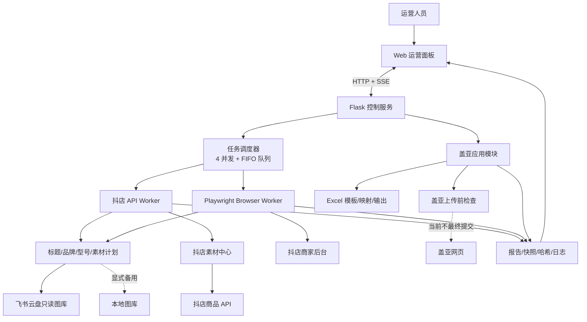
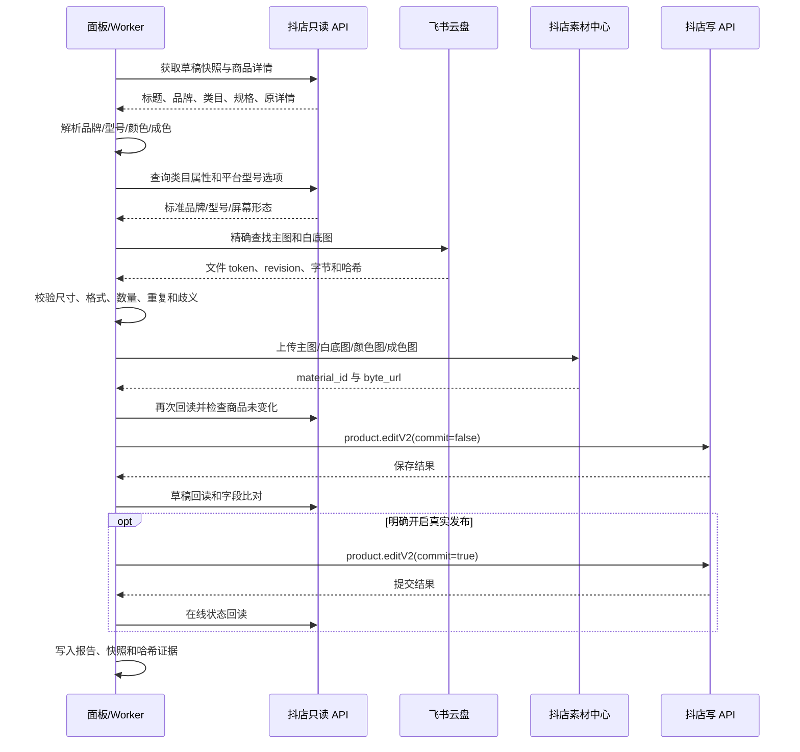

# 爱回收 · 智能运营平台技术报告

> 文档版本：1.0  
> 基线日期：2026-09-24  
> 项目目录：`/Users/atrenew/doudian-panel`  
> 文档范围：当前代码已经实现的能力、业务规则、技术架构、安全边界、验证现状和后续演进建议  
> 保密说明：本文不包含 App Secret、Access Token、浏览器 Cookie、店铺会话等敏感值。

---

## 1. 执行摘要

“爱回收 · 智能运营平台”是一个面向二手手机及消费电子商品运营的自动化工作台。它把原本分散在飞书云盘、盖亚、抖店商家后台、本地 Excel 和人工浏览器操作中的流程，收敛为一套可追踪、可校验、可停止、可重试的任务系统。

项目当前包含两条主业务链路：

1. **抖店自动上架链路**：扫描店铺草稿，识别品牌、型号、成色和颜色，从飞书云盘或本地图库获取素材，上传抖店素材中心，更新商品草稿，并在明确开启发布时提交商品和回读结果。
2. **盖亚铺货链路**：读取下载目录中的双维成色发品模板和货品维度映射表，过滤非国行商品，匹配运营输入的手机型号或标准 SKU，生成经过逐行校验和哈希保护的 Excel，并完成盖亚网页上传前检查。

系统不是“盲目点击网页”的脚本，而是由以下部分共同构成的受控自动化系统：

- Web 运营面板；
- Flask 控制服务；
- 最多四店并发、超出后先进先出的任务队列；
- 抖店 API 主链路；
- Playwright 浏览器备用链路；
- 飞书云盘主图库与本地备用图库；
- 品牌、型号、颜色、成色和图片的确定性匹配规则；
- 保存草稿、真实发布、失败分类、读回校验和安全重试机制；
- 盖亚 Excel 生成、预览、下载、取消和提交前检查模块。

当前成熟度可以概括为：

| 模块 | 当前状态 | 说明 |
| --- | --- | --- |
| 抖店 API 素材上架 | 已实现，可运行 | 支持草稿保存和受控真实发布，写后必须回读 |
| 抖店浏览器链路 | 已实现，作为备用 | 使用独立 Chrome Profile，处理 API 无法覆盖或需要 UI 校验的场景 |
| 飞书云盘图库 | 已接入，主来源 | 只读检索和下载，素材上传到抖店后才写入商品 |
| 本地图库 | 已接入，备用来源 | 云盘不能安全唯一命中时，只有显式选择备用链路才使用 |
| 多店并发与排队 | 已实现 | 最多 4 家店并行，第 5 家起进入 FIFO 等待队列 |
| 盖亚 Excel 生成 | 已实现 | 支持模板识别、国行过滤、映射版本、预览、生成和下载 |
| 盖亚浏览器最终提交 | 尚未开放 | 当前只做到已登录页面探测和上传前检查，不把“点过按钮”视为成功 |
| 盖亚到抖店草稿唯一交接 | 待实现 | 需要盖亚逐行回执与新增草稿商品 ID 建立强关联 |

---

## 2. 项目背景

### 2.1 原业务流程的问题

二手商品上架不是简单地填写标题和上传一张图片。实际流程同时涉及：

- 多个抖店店铺；
- 大量草稿商品；
- 不同品牌、型号、版本后缀和平台标准型号；
- 主图、白底图、颜色规格图、成色说明图和已有商详图；
- 平台品牌 ID、型号属性、屏幕形态等结构化字段；
- 盖亚批量发品 Excel；
- 商品保存草稿和真实发布的不同风险等级；
- API 登录态、浏览器登录态、素材中心和任务日志。

纯人工操作存在四类核心问题：

1. **效率问题**：同样的选店、找图、选型号、上传和保存动作需要重复执行。
2. **一致性问题**：运营人员对空格、大小写、品牌别名、版本后缀的判断可能不一致。
3. **安全问题**：错误型号、错误颜色图或错误店铺素材一旦真实发布，后续修复成本高。
4. **可追踪问题**：仅凭页面操作很难回答“处理了哪件商品、使用了哪张图、失败在哪一步、是否真的发布成功”。

### 2.2 建设目标

项目的目标不是无限扩大自动操作范围，而是把可确定的工作自动化，把不能唯一确定的工作明确拦截：

- 能够确定时自动执行；
- 存在歧义时停止并记录原因；
- 所有写入都有输入证据、执行记录和结果回读；
- 默认优先保存草稿，真实发布必须经过显式配置；
- 多店同时运行时互相隔离；
- 浏览器页面变化、平台限流或网络异常时不能造成重复提交；
- 盖亚模板生成、盖亚受理、抖店草稿生成和抖店发布必须是不同状态，不能混为一个“成功”。

### 2.3 非目标

当前系统明确不承担以下职责：

- 不负责修改飞书云盘中的源文件和文件夹；
- 不在多个可能型号、多个主图目录或多个 SKU 中随机猜测；
- 不自动修改未列入本次计划的商品字段；
- 不把 HTTP 请求成功、按钮点击成功当作业务成功；
- 不在当前阶段自动完成盖亚最终提交和盖亚到抖店的无证据关联；
- 不替代平台权限、平台审核和运营决策。

---

## 3. 总体架构

### 3.1 架构总览



### 3.2 控制面与执行面分离

系统分为两个逻辑平面：

**控制面**负责：

- 接收面板操作；
- 校验店铺、模式、数量和安全开关；
- 分配并发槽位；
- 排队、启动、停止和回收任务；
- 汇总日志、进度和错误；
- 向浏览器通过 SSE 推送实时状态。

**执行面**负责：

- 调用抖店 API；
- 控制已登录浏览器；
- 扫描草稿；
- 解析商品身份；
- 查找和校验图片；
- 上传素材；
- 保存草稿或真实发布；
- 回读并生成证据报告。

这种分离让前端页面不用直接持有平台密钥，也让任务即使离开当前浏览器标签页仍能继续运行。

### 3.3 主要技术栈

| 层次 | 技术 | 用途 |
| --- | --- | --- |
| 前端 | HTML、CSS、原生 JavaScript | 工作区切换、任务卡片、队列、日志、盖亚表单、人物交互 |
| 服务端 | Python、Flask | HTTP API、任务管理、SSE、静态资源服务 |
| 浏览器自动化 | Playwright + Chromium | 复用登录态、点击控件、上传文件、保存草稿和页面校验 |
| 平台接口 | 抖店开放平台 API | 草稿扫描、商品详情、类目属性、素材上传、商品编辑和发布 |
| 云文件 | 飞书云盘 API | 只读目录遍历、文件元数据、版本和字节下载 |
| Excel | openpyxl + 自定义流式检查器 | 盖亚模板识别、映射导入、生成、逐行回读 |
| 图片 | Pillow 等 | 格式、尺寸、比例、哈希和透明素材验证 |
| 状态存储 | JSON、JSONL、文件锁、原子替换 | 批次、报告、快照、缓存、处理记录和审计 |

---

## 4. 工程结构与模块边界

项目按“面板控制、业务领域、平台集成、可执行脚本”划分职责。

| 路径 | 主要职责 |
| --- | --- |
| `panel_server.py` | Flask 服务、任务状态、并发槽、FIFO 队列、SSE、面板 API |
| `panel_runner.py` | 浏览器任务进程、登录检查、店铺切换、草稿循环、熔断和温和停止 |
| `panel_api_media_runner.py` | 纯 API 素材任务进程，不启动 Playwright |
| `test_doudian_batch.py` | 浏览器链路的商品处理核心，包含品牌/型号、图片、库存、保存/发布步骤 |
| `doudian_api.py` | 抖店请求签名、Token、基础 API 客户端和型号候选逻辑 |
| `integrations/doudian/` | 抖店只读网关、窄权限写网关、商品服务和 Token 存储 |
| `integrations/feishu_drive/` | 飞书云盘只读客户端 |
| `app/material_pipeline/` | 云盘素材解析、图片规则、缓存、上传编排和官方型号登记 |
| `app/listing_preflight/` | 浏览器无关的上架前检查和本地图库精确解析 |
| `app/listing_execution/` | 不可变执行计划、计划哈希和交接边界 |
| `app/sku_color_images/` | 颜色规格值与本地/云端图片的精确匹配 |
| `app/grade_detail_images/` | 99新、95新、9新及三合一成色图规则 |
| `app/gaia_listing/` | 盖亚领域合同、映射导入、批次生成、状态、取消和 API |
| `integrations/gaia_browser/` | 盖亚已登录页面探测和上传前检查，不负责最终确认 |
| `scripts/` | 金丝雀、批处理、快照、预检、修复、审计等独立入口 |
| `panel_data/` | 运行报告、缓存、批次记录、任务数据等本地状态 |
| `tests/` | 业务规则、API、队列、UI、图片和安全边界测试 |

重要的边界原则是：

- Excel 模块不直接控制浏览器；
- 图片解析模块不直接发布商品；
- 只读网关不能调用写接口；
- 写网关只允许单件商品、固定字段和预期商品 ID；
- UI 不复制后端业务规则；
- 浏览器兼容逻辑不能改变品牌和型号的业务决策。

---

## 5. 运营面板

### 5.1 首页与工作区

当前面板包含统一的爱回收品牌导航、中央人物视觉区，以及盖亚铺货和抖店上架两个业务工作区。人物开箱、眼睛跟随和挥手属于前端品牌交互，不参与商品业务状态。

近期已完成的视觉统一包括：

- 盖亚和抖店使用各自正式品牌标识；
- 两个业务入口宽度、边距和卡片栅格统一；
- 盖亚左右区域使用相同列宽并对齐；
- 桌面端、窄屏和移动端具有独立响应式规则；
- 业务功能与装饰性交互分文件管理，避免人物动画影响任务逻辑。

### 5.2 抖店面板功能

抖店工作区支持：

- 选择或沿用当前登录店铺；
- 选择 API 素材链路或浏览器备用链路；
- 选择测试模式或批量模式；
- 指定数量或全量草稿扫描；
- 默认“仅保存草稿，不发布”；
- 显式开启真实发布；
- 展开高级参数，指定商品或分级发布；
- 查看运行中、排队中、已完成和失败任务；
- 实时查看处理数量、成功数、失败数、当前步骤和结构化日志；
- 温和停止、取消排队任务、清理任务日志；
- 查看聚合错误和人工处理原因。

### 5.3 盖亚面板功能

盖亚工作区按阶段组织：

1. 识别下载目录中的最新空模板；
2. 读取或手动上传型号映射表；
3. 选择目标店铺、场域和成色；
4. 输入手机型号或标准 SKU；
5. 查看唯一命中或多候选；
6. 预览待生成行；
7. 生成输出文件并做逐行回读；
8. 完成上传前检查；
9. 下载生成结果。

当前按钮不会绕过后端检查直接操作盖亚。只有模板、映射、成色和型号都满足合同，才能生成输出。

### 5.4 实时同步机制

前端使用 Server-Sent Events（SSE）订阅 `/api/stream`：

- 服务端推送任务状态、进度、日志和队列位置；
- 浏览器断线后按重试间隔自动连接；
- 页面刷新后重新通过 `/api/tasks` 获取任务快照；
- Worker 输出的 `##EVT{...}` 结构化事件会转换为面板状态；
- 普通文本日志仍会保留，方便人工排查。

SSE 是单向推送，启动、停止和删除任务仍通过普通 HTTP API 完成，职责清晰。

---

## 6. 任务调度、并发与队列

### 6.1 并发模型

当前固定最大并发数为 4：

- API Worker 只占用任务槽，不占用浏览器 Profile；
- 浏览器 Worker 会绑定一个独立 Chrome 用户目录；
- 同一店铺不允许同时存在两个运行中或排队中的任务；
- 超过 4 个活跃任务后，新任务进入 FIFO 队列；
- 任一任务结束后，调度器立即把最早排队任务放入空闲槽。

### 6.2 为什么需要独立浏览器 Profile

不同店铺同时操作时，如果复用一个浏览器会话，切店动作可能互相覆盖。系统为四个并发槽分别维护：

- 独立 Cookie；
- 独立 Local Storage；
- 独立登录状态；
- 独立页面上下文。

因此四店并发不是四个标签页共享同一账号，而是四套隔离会话。

### 6.3 排队状态

任务主要状态包括：

```text
queued → starting → waiting_login → running
                               ├→ stopping → stopped
                               ├→ done
                               └→ error
```

- `queued`：没有可用槽位；
- `waiting_login`：浏览器已打开，等待人工登录；
- `running`：正在扫描或处理商品；
- `stopping`：收到温和停止请求，当前商品完成后退出；
- `done`：任务正常结束；
- `error`：启动或执行异常。

### 6.4 当前持久化边界

运行日志和业务报告写入磁盘，但等待队列本身当前保存在服务进程内存中。因此服务重启会清空尚未启动的排队任务。这是当前单机版本的重要边界；如果未来需要多机、高可用或重启续跑，应把队列迁移到 SQLite/PostgreSQL 加 Redis 或其他持久化任务系统。

---

## 7. 抖店链路：从草稿到发布

### 7.1 两种执行方式

系统保留两条互斥链路：

| 链路 | 适用场景 | 优点 | 约束 |
| --- | --- | --- | --- |
| API 素材链路 | 批量、无人值守、结构化字段可覆盖 | 稳定、快、资源占用低、易回读 | 受开放平台字段和权限限制 |
| 浏览器备用链路 | API 暂不支持或需要页面控件验证 | 能覆盖真实后台交互 | 页面 DOM 变化、登录态和渲染速度会影响稳定性 |

系统不会在 API 出错后自动切浏览器发布。自动切换会扩大不可控范围，因此备用链路必须由运营明确选择。

### 7.2 API 全链路

单件商品的 API 流程如下：



### 7.3 草稿扫描

批量模式会完整分页读取草稿列表，而不是固定只取 10 件。测试模式可以限制数量，批量模式的目标数量取本次快照中的实际草稿数量。

扫描阶段记录：

- 商品 ID；
- 当前标题；
- 草稿状态；
- 当前店铺；
- 分页数量；
- 快照时间；
- 是否已经成功处理；
- 上次失败是否属于需要重新检查的图片缺失。

已经完成的商品不会在同一处理记录中被重复发布；因图库缺失而跳过的商品会在后续运行时重新检查，因为运营可能已经补充素材。

### 7.4 商品身份解析

商品身份由商品详情优先确定：

1. 读取 API 商品详情中的标题、品牌和类目；
2. 详情标题可用时，以详情为准；
3. 只有详情身份不可用时，才使用同一草稿快照里的标题作为备用；
4. 从标题中清除成色、容量、网络、营销语等非型号部分；
5. 得到来源品牌、来源型号、目标品牌和目标型号；
6. 生成后续步骤共同使用的唯一计划。

这样可以避免列表页和详情页标题短暂不同步时把一件商品识别成两个型号。

### 7.5 保存草稿与真实发布

系统把两个动作严格分开：

- `commit=false`：保存草稿；
- `commit=true`：提交发布。

默认执行保存草稿。真实发布需要面板和后端同时允许，API 发布还受专门环境开关保护。即使接口返回成功，也必须通过商品详情或在线状态回读确认，才能把结果记录为 `published_readback`。

### 7.6 API 链路不修改的内容

当前全媒体 API 链路聚焦图片、详情和已批准的商品属性，不主动改写 SKU 价格、库存和 SKU 结构。主要原因是 SKU 是交易核心数据，风险高于素材字段。浏览器旧链路虽然具备更多页面能力，但也必须受规格开关和终检保护。

---

## 8. 品牌与型号匹配逻辑

### 8.1 核心原则

品牌和型号使用单向决策流程：

```text
标题解析
  → 品牌规范化
  → 完整型号规范化
  → 生成平台目标方案
  → 平台候选查询
  → 唯一匹配
  → 品牌+型号联合终检
  → 才允许进入图片和写入步骤
```

任何特例只能改变“目标是什么”，不能绕过“先品牌、后型号、再终检”的顺序。

### 8.2 品牌规则

品牌规则由 `BRAND_MAP`、品牌别名和严格比较函数维护。例如：

- 苹果目录位于“苹果”品牌下，型号为 iPhone；
- Xiaomi/小米与 Redmi/红米是不同品牌，不做跨品牌兼容；
- OPPO、vivo、iQOO、荣耀、华为、三星、真我等统一大小写和中英文别名；
- 店铺当前页面值不能替代目标品牌判断。

### 8.3 型号规范化

规范化只处理不会改变产品身份的形式差异：

- 大小写；
- 多余空格；
- 常见全角/半角标点；
- 品牌前缀；
- 已审核的别名；
- 已知尾部版本描述，如 `5G版`、`活力版`，且只在完整型号未命中后尝试。

以下核心后缀不会被删除：

- Pro；
- Max；
- Ultra；
- Fold；
- Flip；
- `+` / Plus。

删除这些后缀会把不同商品合并为一个型号，因此属于禁止行为。

### 8.4 平台型号选择

当前 API 代码采用保守唯一匹配：

1. 原文完全一致；
2. 忽略大小写后完全一致；
3. 统一空格、标点和品牌前缀后完全一致；
4. 只有结果唯一时才接受。

不使用包含匹配，也不在多个近似项中随机选择。无法唯一确认的商品进入人工队列。该行为比“任选一个候选”慢，但能避免把 X60、X60 Pro、X60i 等不同型号写混。

### 8.5 官方型号登记

当图库名称和平台名称仍不能唯一对应时，系统可以使用经过人工审核的 `official_models.json`：

- 保存品牌官网标准名称；
- 保存来源 URL；
- 只作为受控别名证据；
- 不在运行时临时搜索互联网并直接决定发布。

这使“官方名称”成为可审计配置，而不是每次运行结果不同的在线猜测。

---

## 9. 图片素材链路

### 9.1 数据来源优先级

当前设计为：

1. **飞书云盘是主来源**；
2. **本地图库是显式备用来源**；
3. 云盘只读，不重命名、不移动、不删除；
4. 飞书链接不能直接写入抖店商品；
5. 图片必须经过“下载字节 → 抖店素材中心 → 平台 URL → 商品字段”。

浏览器链路可以配置“云盘优先、本地备用”。API 主链路缺少店铺素材文件夹配置时会直接阻断，不会悄悄切换到浏览器或其他店铺目录。

### 9.2 云盘目录模型

默认目录结构为：

```text
<素材根目录>/
├── 抖音主图/
│   └── <店铺ID>/<品牌>/<型号>/主图/<图片>
└── 白底图库/
    └── 手机/<品牌>/<型号>/白底图/<图片>
```

部分店铺的目录存在额外运营分组层。解析器采用有界广度优先搜索：

- 当前层找不到预期文件夹时继续向下一层；
- 最近深度的唯一精确目录获胜；
- 同一最近深度出现两个同名候选时立即阻断；
- 不依赖文件系统返回顺序；
- 不跨品牌、跨型号借图。

这种方式解决“图库还需要往下找一层”的实际问题，同时保留重复目录的安全拦截。

### 9.3 型号文件夹匹配

文件夹解析顺序为：

1. 完整型号精确匹配；
2. 规范化后的完整型号精确匹配；
3. 已审核规则别名；
4. 去除一个已知尾部版本描述；
5. 官方型号登记。

若去掉版本后使用了基础型号目录，系统还会检查商品全部颜色是否能在该目录的图片名称中得到证明。不能证明时拒绝使用，防止把基础版图片用于活力版、至尊版等不同机型。

### 9.4 主图和白底图规则

当前代码规则以 `app/material_pipeline/domain.py` 为准：

| 项目 | 当前规则 |
| --- | --- |
| 支持格式 | JPG、JPEG、PNG、WebP |
| 单图上限 | 3 MiB |
| 尺寸 | 至少 600×600 |
| 形状 | 正方形 |
| 白底图最少 | 2 张 |
| 白底图最多 | 4 张 |
| 有真实主图 | 1 张主图 + 2～4 张白底图 |
| 没有真实主图 | 至少 3 张白底图；第 1 张作为主图，其余至少 2 张作为白底图 |

补充规则：

- `主图` 子目录里只有一张受支持图片时，可接受任意文件名；
- 存在两张非标准命名候选时拒绝自动选择；
- 主图和白底图按 SHA-256 去重；
- 无效的额外白底图可记录原因后省略，但剩余图片必须满足最低数量；
- 找到一个已存在但不合格的主图时，不会悄悄改用白底图；
- 是否允许“白底图顶替主图”由显式开关控制，并在每件商品日志中告警。

旧版说明中曾出现“必须 3 张白底图”或“白底图需要 4 张”的描述。当前实现已经调整为上述 2～4 张规则；后续维护应以代码合同和本报告为基准，并同步清理旧文档中的历史表述。

### 9.5 颜色规格图

颜色图读取商品第一规格组中的实际颜色值，并与同型号图库文件精确对应：

- 使用平台 `spec_detail_id` 作为最终槽位身份；
- 颜色名统一空格和受控别名，但不跨颜色猜测；
- 左右顺序依据平台规格槽位，不依据文件枚举顺序；
- 完整覆盖全部颜色时上传规格图；
- 只匹配到部分颜色时，整组规格图不上传，但商品其他部分可以继续；
- 日志记录总颜色数、已匹配、缺失、无效和最终策略。

“部分匹配时整组不上传”的原因是抖店 `spec_pic` 使用位置序列，缺少中间槽位会把后续图片错绑到其他颜色。该规则实现了“有完整安全映射就上，没有就不上”，而不是冒险上传部分图片。

### 9.6 成色详情图

系统识别商品中唯一的“成色”规格组，支持：

- 99新；
- 95新；
- 9新/90新。

规则为：

- 商品同时包含三种成色时，使用图库中唯一的“三合一”图；
- JPEG、JPG、PNG、WebP 均可作为受支持图片；
- 商品只包含一种或两种成色时，分别使用对应成色图；
- 没有成色规格组、出现两个成色规格组、存在未知成色或图片重复时阻断；
- 新成色图加入前会移除已识别的旧成色图和禁用图，不删除无法确认身份的普通详情图。

### 9.7 原详情图和数量边界

详情处理不再依赖“原图必须恰好 6 张或 13 张”的旧规则，而是按语义保留和替换：

1. 读取原详情 URL；
2. 识别旧成色图和已知禁用图；
3. 保留其他原详情图及其顺序；
4. 加入新的成色图；
5. 过滤后原详情图少于 2 张则阻断；
6. 新详情总数超过 20 张则阻断；
7. 主图、白底图、颜色图和详情图总计超过 50 张则阻断。

这样既能兼容不同数量的历史商详，又不会在无法判断图片含义时盲删。

### 9.8 素材缓存和一致性

云盘文件使用以下身份信息：

- `file_token`；
- `revision`；
- SHA-256；
- 文件大小；
- 抖店 `material_id`；
- 抖店 `byte_url`。

缓存不保存云盘凭证和完整文件字节。写入商品前会再次读取源文件并核对哈希；缓存中的抖店素材 ID 也会重新验证。若运营在任务中途替换云盘文件，系统会发现版本或哈希变化并停止，而不会把预检过的 A 图和后来替换的 B 图混在一次提交中。

---

## 10. 商品字段写入与回读校验

### 10.1 不可变执行计划

在写入前，系统把关键输入固化为计划：

- 店铺 ID；
- 商品 ID；
- 品牌和型号；
- 平台型号选项；
- 屏幕形态；
- 主图、白底图、颜色图和成色图；
- 源文件哈希；
- 计划动作：保存草稿或发布；
- 计划校验和。

执行时不能临时换成另一个商品、另一家店或另一套素材。计划变化必须重新预检。

### 10.2 写入前竞态保护

图片上传可能持续数秒。在真正调用商品写接口前，系统再次读取商品详情，并比较来源指纹。如果标题、规格或关键身份已经被其他人修改，本次任务停止，避免用旧计划覆盖新编辑。

### 10.3 写后校验

保存草稿后核对：

- 主图区 URL 数量和顺序；
- 白底图独立字段是否保留；
- 颜色图与 `spec_detail_id` 是否一一对应；
- 详情图顺序和数量；
- 品牌 ID；
- 型号和屏幕形态；
- SKU 结构是否保持不变；
- 计划外字段是否被修改。

只有全部满足，结果才记为 `draft_verified`。发布后还需读回在线状态，才记为 `published_readback`。

### 10.4 规格开关保护

浏览器页面中的“修改规格信息”必须保持关闭：

- 每件商品都会重新定位开关；
- 明确检测为开启时才点击关闭；
- 无法确认 `aria-checked` 或视觉状态时拒绝盲点；
- 未确认关闭时不继续保存和发布；
- 颜色规格图的“添加规格图”只在需要且映射完整时打开。

API 链路不依赖页面开关，而是只写批准的 `spec_pic` 字段，并用回读确保没有改变 SKU 结构。

---

## 11. 重试、幂等与异常控制

### 11.1 提交重试

真实发布默认采用“首次提交 + 最多 2 次安全重试”：

1. 第一次提交；
2. 失败后先回读商品状态；
3. 如果平台实际上已受理，立即停止重试；
4. 只有明确属于平台拒绝、频控等已知可重试错误时才继续；
5. 网络断开、超时后结果未知时不盲目重试；
6. 每次重试前检查商品指纹没有变化；
7. 日志记录尝试次数、等待时间和最终读回结果。

这解决了“提交接口报错但平台可能已经成功”的重复发布风险。

### 11.2 熔断器

浏览器批处理维护滑动失败窗口。默认规则包括：

- 最近 20 件中的失败率超过阈值；或
- 同一种失败连续出现 3 次。

满足条件时自动停止后续商品，防止页面结构变化、账号失效或图库配置错误扩散到整店。人工队列类问题不计入系统故障熔断，因为它们不是执行器失效。

### 11.3 温和停止

面板停止操作不会在正在写入商品时直接杀死进程：

- 写入停止标记；
- 当前商品执行到安全边界；
- 完成报告和回读；
- 不再启动下一件；
- 状态进入 `stopped`。

只有进程失去响应且人工确认后才应使用强制终止。

### 11.4 失败分类

失败被归入可行动类别，而不是只输出堆栈：

- 品牌无法匹配；
- 型号无法唯一确认；
- 主图缺失或歧义；
- 白底图不足；
- 颜色图不完整；
- 成色组异常；
- 图片尺寸、格式或大小不合法；
- 素材上传失败；
- 规格开关无法确认关闭；
- 草稿保存失败；
- 发布失败或回读不一致；
- 登录或店铺切换失败。

面板可以按店铺、商品和原因汇总，方便运营补图或人工处理。

---

## 12. 浏览器自动化实现

### 12.1 Playwright 原理

Playwright 不是在屏幕坐标上“模拟鼠标”，而是通过浏览器自动化协议控制 Chromium：

- 打开页面；
- 读取 DOM；
- 按文本、角色、属性或结构定位控件；
- 等待元素可见、可点击和网络稳定；
- 触发真实点击、输入和文件选择；
- 读取页面反馈和控件状态；
- 截图、保存日志并处理弹窗。

系统使用持久化浏览器上下文，因此人工登录后的 Cookie 可在后续任务中复用。

### 12.2 登录和店铺校验

Worker 启动后：

1. 使用分配到的 Profile 打开抖店草稿页；
2. 最多等待约 180 秒人工登录；
3. 只有草稿页面真实出现才判定登录成功；
4. 读取当前店铺 ID/名称；
5. 与任务目标店铺比较；
6. 必要时执行切店；
7. 切换后再次验证，失败则终止。

不能仅凭右上角名称近似或页面 URL 推断已经进入目标店铺。

### 12.3 页面变化应对

关键控件采用多层定位策略，但不通过模糊点击扩大风险：

- 优先稳定属性和可访问角色；
- 其次使用明确文字和附近结构；
- 操作后必须读取状态变化；
- 找不到或状态未知时阻断；
- 日志输出定位方式、当前状态和页面上下文。

因此页面改版通常会导致任务安全失败，而不是点击到相邻按钮继续发布。

---

## 13. 盖亚铺货链路

### 13.1 输入文件角色

盖亚链路有两个完全不同的文件：

1. **双维成色发品模板**：本次要填写的空模板；
2. **抖音直播货架货品价格规则数据导出（货品维度）**：标准 SKU 参考映射，不是本次全部上架清单。

系统不会把映射表中的全部记录自动写入模板。运营必须明确输入本次型号或 SKU。

### 13.2 映射导入

映射导入支持 `.xlsx` 和 `.csv`：

- 自动识别目标工作表和表头；
- 支持约 25 万行上限并采用流式读取；
- 以 `standardSkuId` 为主键；
- 重复业务行稳定去重；
- 同一 SKU 的品类、品牌或型号冲突会阻断；
- 若存在“标品名称”列，只保留明确包含“国行”的记录；
- 非国行和未明确国行的行数、SKU 数写入审计信息；
- 保存映射不可变副本、SHA-256 和有效记录数。

### 13.3 运营型号输入

前端支持每行输入一个型号，推荐格式为：

```text
苹果,iPhone 17 Pro
华为,Mate 60 Pro
REDMI,K90
```

只输入型号也可尝试匹配，但跨品牌重名时会要求补充品牌。解析复用抖店图库的品牌和型号规范化规则。

同一个型号可能因颜色、容量或网络版本对应多个标准 SKU。系统会把候选展示给运营，不自动选择其中一个。这是盖亚链路与抖店平台“型号属性”不同的地方：盖亚需要的是具体标品 SKU，而不是泛型号名称。

### 13.4 Excel 填写合同

当前模板 A:H 的写入规则为：

| 列 | 字段 | 规则 |
| --- | --- | --- |
| A | 场域 | 前端选择：`1` 直播间，`2` 直播货架 |
| B | 聚合标识 | 固定 `A` |
| C | 是否质检链接 | 固定 `1` |
| D | 标品 ID | 运营本次确认、且存在于映射版本中的 `standardSkuId` |
| E | 抖音成色 ID | 99新或95新对应的真实平台 ID |
| F | 名称前缀 | 留空 |
| G | 选品策略 | 手机固定 `D且E且G`，其他品类留空 |
| H | 商品规则前缀 | 留空 |

创建数量固定为 1。

### 13.5 模板生成保护

生成过程遵循：

1. 识别下载目录中唯一有效空模板；
2. 计算源模板 SHA-256；
3. 检查 A:H 数据区为空；
4. 校验映射版本和目标 SKU；
5. 校验成色 ID；
6. 复制模板到独立输出目录；
7. 只写副本的 A:H；
8. 逐行读回；
9. 计算输出 SHA-256；
10. 保存批次状态和事件。

源模板永不覆盖。前端预览携带的模板哈希和成色必须与生成时一致，防止预览后模板被替换。

### 13.6 批次状态

盖亚状态被拆分为多个事实阶段，例如：

```text
selected → inspected → generated → validated
          → confirmed → submitted → accepted
          → waiting_drafts → matched → handedoff
```

失败、待人工确认和取消是独立状态。特别注意：

- `generated` 只表示本地 Excel 生成成功；
- `validated` 只表示上传前检查通过；
- `submitted` 需要真的提交；
- `accepted` 需要网页明确回执；
- `matched` 需要盖亚行与抖店草稿唯一关联；
- `handedoff` 才代表可以交给后续抖店链路。

### 13.7 当前尚未完成的盖亚能力

当前浏览器模块已经验证：

- 登录后进入抖音渠道；
- 打开双维成色发品；
- 打开批量操作弹窗；
- 识别店铺下拉；
- 设置数量 1；
- 识别文件选择器；
- 确认“确定”按钮的可用性；
- 安全取消。

但尚未开放：

1. 真实点击最终确定并取得可追踪盖亚受理结果；
2. 失败后最多两次、保持幂等的盖亚提交重试；
3. 盖亚逐行回执与抖店新增草稿商品 ID 的唯一关联；
4. 通过单件金丝雀后再开放批量提交。

因此当前面板中的盖亚“开始”应理解为“生成并完成上传前检查”，不能宣称已经真实发品。

---

## 14. 状态、日志和审计

### 14.1 日志层次

系统同时保留三类信息：

1. **实时运行日志**：面板可读，包含时间、标签和说明；
2. **结构化事件**：状态、进度、当前商品、错误类型和统计；
3. **审计报告**：处理前快照、处理后快照、素材哈希、请求计划、平台回读和最终结果。

### 14.2 关键报告字段

单件 API 报告通常包含：

- 店铺 ID、商品 ID；
- 来源标题及来源；
- 解析品牌、型号和平台选项；
- 主图来源、白底图和是否替代主图；
- 颜色总数、匹配数、上传数和缺失原因；
- 成色值和使用三合一/单图策略；
- 原详情图数量和目标详情图数量；
- 上传素材 ID 和 SHA-256；
- 写入 Payload 哈希；
- 保存草稿/发布的尝试次数；
- 写后回读结果；
- 人工队列原因。

### 14.3 文件安全

关键 JSON 使用临时文件写入后原子替换，敏感报告采用受限文件权限。`env.local`、Chrome 用户目录和 Token 存储不应提交到版本库，也不应直接打包给其他机器。

---

## 15. 安全设计

### 15.1 最小写权限

抖店集成拆分为只读和窄写网关：

- 只读网关只允许商品列表、商品详情、SKU 详情和类目属性等接口；
- 素材网关只处理图片上传和素材校验；
- 单商品写网关绑定店铺 ID 和商品 ID；
- 写入字段有明确白名单和数量限制；
- 保存与发布使用不同动作；
- 未通过计划校验不能启动写入。

### 15.2 Token 和配置

- 每家店使用独立 Token；
- 刷新 Token 时只更新目标店铺；
- 配置读写使用文件锁和原子替换；
- 对象打印时隐藏密钥；
- 面板配置状态只显示“是否配置”，不返回具体值。

### 15.3 Web 暴露风险

服务默认可监听 `0.0.0.0:8080` 供局域网访问，但当前面板不是公网 SaaS：

- 没有完整的用户登录和 RBAC；
- 没有 HTTPS 终止；
- 没有 CSRF、防暴力请求和公网 WAF；
- 本地浏览器 Profile 含登录态；
- 任务队列是单机内存状态。

因此当前适合可信局域网或受控 VPN，不应直接把 8080 端口暴露到互联网。正式上线应增加反向代理、HTTPS、身份认证、权限、审计和网络访问控制。

---

## 16. 部署与运行

### 16.1 当前单机运行方式

项目当前主要运行在 macOS 主机：

- 面板端口：8080；
- `启动面板.command` 用于启动和打开本地页面；
- LaunchAgent 支持开机自启和进程拉起；
- Windows 提供 `启动运营面板.bat` 作为备用入口；
- 四个 Chrome Profile 支持浏览器并发；
- `panel_data/`、`logs/` 和报告目录保留本地证据。

### 16.2 环境依赖

运行时需要：

- Python；
- Flask；
- Playwright 和 Chromium；
- openpyxl；
- Pillow；
- 飞书和抖店相关 HTTP 依赖；
- 已配置的 `env.local`；
- 已登录的浏览器 Profile（仅浏览器链路）。

当前仓库没有统一的 `requirements.txt` 或锁定文件，这是可复现部署的缺口。建议补充：

- `requirements.txt` 或 `pyproject.toml`；
- 受控虚拟环境；
- Python 版本固定；
- Playwright 浏览器版本安装步骤；
- 启动前依赖自检。

### 16.3 当前测试解释器差异

2026-09-24 核验结果：

- 使用系统运行解释器 `/usr/bin/python3`：发现 409 个测试，403 个通过，5 个错误、1 个失败；6 个问题集中在旧的 `test_panel_execution_api.py`，它仍假设 `panel_server` 暴露已删除的 `PREFLIGHT_REPORT_DIR` 和旧路由返回行为，属于测试与当前 API 边界不同步。
- 使用当前 shell 默认的 Homebrew Python 3.14：缺少 Flask、Playwright、openpyxl、Pillow，并存在 `pyexpat` 动态库不兼容，不能作为项目测试结果。

这说明业务测试主体通过，但还不能宣称“全量测试全部通过”。上线前应先统一解释器和依赖，再修复或迁移 6 个旧接口测试。

### 16.4 容量与并发建议

API Worker 的资源消耗主要是图片下载、哈希和 HTTP 请求；浏览器 Worker 还要运行 Chromium，内存占用明显更高。四店并发时应重点监控：

- 四个 Chromium 进程及子进程内存；
- 图片下载和素材上传带宽；
- `panel_data` 报告、缓存和 Chrome Profile 的磁盘增长；
- 抖店和飞书接口频控；
- 单任务耗时和排队长度。

用户当前主机磁盘总量约 40 GB、已使用约 8.5 GB、可用约 29 GB，短期足够运行，但 Chrome Profile、调试截图和审计快照会持续增长。建议设置保留策略，而不是永久保存所有临时文件。

---

## 17. 测试体系与验收标准

### 17.1 测试覆盖方向

仓库中约有 447 个测试函数定义，`unittest` 当前实际发现 409 个测试。覆盖范围包括：

- 品牌、型号和尾部版本解析；
- Redmi/小米品牌隔离；
- 主图和白底图目录；
- 云盘嵌套目录与重复目录；
- 图片去重和无主图策略；
- 颜色规格图完整/缺失策略；
- 成色图和三合一图；
- 详情图替换；
- 抖店 API 签名和写网关；
- 保存草稿和真实发布保护；
- 执行计划和哈希；
- 多店任务队列；
- 面板状态同步；
- 盖亚模板、映射、状态和工作流保护；
- 稳定性与熔断策略；
- 人物前端资源和交互状态。

### 17.2 单件金丝雀

任何新的店铺、接口、图片规则或发布方式都应先执行一件商品：

1. 只读快照；
2. 预检；
3. 保存草稿；
4. 人工查看结果；
5. 回读报告一致；
6. 再开放真实发布；
7. 最后扩大批量和并发。

### 17.3 抖店批量验收

批量任务成功标准：

- 实际处理数量与快照目标一致，或每个短缺都有明确原因；
- 不跨店使用主图；
- 品牌和型号唯一；
- 主图、白底图、颜色图和成色图符合计划；
- 规格开关状态安全；
- SKU 结构未改变；
- 每次保存或发布均有读回；
- 同一商品不因重试重复提交；
- 温和停止后不再启动下一件；
- 四店并发时日志、Profile 和处理记录不串店。

### 17.4 盖亚验收

盖亚真正完成需要同时满足：

- 参考映射唯一识别；
- 非国行数据已剔除；
- 本次 SKU 明确；
- 模板源哈希一致；
- A:H 逐行读回一致；
- 盖亚页面明确返回受理结果；
- 每一行都能通过回执关联到唯一抖店草稿；
- 重复提交能由幂等键识别；
- 一件金丝雀通过后才开放批次。

当前只完成到上传前检查，因此最后三项仍是后续阶段。

---

## 18. 当前能力清单

### 18.1 已完成

- [x] 爱回收统一运营面板；
- [x] 盖亚和抖店独立工作区；
- [x] 正式品牌 Logo 和统一版式；
- [x] 抖店多店配置与任务卡片；
- [x] 最多四店并发；
- [x] 超出并发后的 FIFO 等待队列；
- [x] 同店重复任务拦截；
- [x] 测试一件和全量批处理；
- [x] API 链路与浏览器备用链路；
- [x] 飞书云盘主图库与本地备用；
- [x] 嵌套目录递归检索和重复目录拦截；
- [x] 主图、2～4 张白底图和缺主图替代策略；
- [x] 颜色规格图完整组上传策略；
- [x] 三成色合并图和非三成色独立图；
- [x] 详情图语义替换；
- [x] 品牌、型号和官方别名登记；
- [x] 保存草稿与真实发布分离；
- [x] 写前竞态检查和写后读回；
- [x] 提交最多两次安全重试；
- [x] 浏览器规格开关关闭保护；
- [x] 熔断器和温和停止；
- [x] SSE 实时日志和进度；
- [x] 盖亚模板识别；
- [x] 货品维度映射导入；
- [x] 国行过滤；
- [x] 型号候选查询；
- [x] 盖亚 Excel 预览、生成、下载和哈希；
- [x] 盖亚批次取消和审计；
- [x] 盖亚浏览器上传前检查。

### 18.2 尚未完成或需要补强

- [ ] 盖亚真实上传金丝雀和明确受理回执；
- [ ] 盖亚逐行回执与抖店草稿商品 ID 唯一绑定；
- [ ] 盖亚批量真实提交及幂等重试；
- [ ] 持久化任务队列和服务重启续跑；
- [ ] 面板用户认证、角色权限和操作审批；
- [ ] HTTPS、反向代理和生产级进程管理；
- [ ] 依赖清单和 Python/Playwright 版本锁定；
- [ ] 修复 6 个与旧执行计划 API 不同步的测试；
- [ ] 自动化报告归档和磁盘清理策略；
- [ ] 指标监控，包括任务成功率、耗时、队列长度、频控和资源占用；
- [ ] 数据库存储，以支持多机部署和审计查询。

---

## 19. 主要风险与建议

### 19.1 平台变化风险

抖店网页 DOM、API 字段和权限可能变化。建议：

- API 优先；
- 浏览器链路保留金丝雀；
- 每次页面改版先运行只读探测；
- 失败率异常立即熔断；
- 不使用屏幕绝对坐标。

### 19.2 图库治理风险

自动化的上限取决于图库质量。建议：

- 品牌、型号、主图、白底图使用固定目录规范；
- 禁止同层重复目录；
- 颜色文件名使用平台颜色原文；
- 保留图片版本和维护记录；
- 定期运行重复目录和重复图片审计；
- 运营补图后重新运行失败商品，而不是人工改程序规则。

### 19.3 型号歧义风险

随机选择近似型号虽然能提高表面发布率，但会把错误带到线上。建议继续采用唯一匹配和人工队列，并逐步扩充经过证据审核的别名表。

### 19.4 单机风险

当前状态依赖一台电脑、一个本地文件系统和若干浏览器 Profile。建议上线顺序：

1. 先统一 Python 虚拟环境和依赖；
2. 把报告、任务和队列迁移到数据库；
3. 把 API Worker 与 Web 面板拆分；
4. 浏览器 Worker 保留在有图形会话的专用机器；
5. 通过 VPN/内网访问，不直接公网暴露；
6. 增加账户登录、RBAC、HTTPS 和审计；
7. 再考虑多机水平扩展。

### 19.5 业务成功定义风险

必须继续坚持：

```text
文件生成成功 ≠ 盖亚受理成功
盖亚受理成功 ≠ 抖店草稿生成成功
草稿保存成功 ≠ 商品发布成功
接口返回成功 ≠ 回读验证成功
```

每个等号右侧都需要独立证据。

---

## 20. 推荐演进路线

### 阶段一：稳定当前单机版

- 修复 6 个旧测试；
- 增加依赖锁定；
- 统一启动解释器；
- 增加日志归档和磁盘清理；
- 完成四店 API 并发的周期性回归。

### 阶段二：完成盖亚闭环

- 选择一个 SKU 做真实上传金丝雀；
- 保存盖亚任务号和逐行回执；
- 通过提交前后抖店全量快照识别新增草稿；
- 对每行回读品牌、型号和成色；
- 建立盖亚行、回执和商品 ID 的唯一关系；
- 通过后再开放批量提交。

### 阶段三：生产化部署

- Nginx/Caddy HTTPS；
- 身份认证和角色权限；
- PostgreSQL 持久化任务、事件和审计；
- Redis/Celery/RQ 等持久化队列；
- API Worker 横向扩展；
- 浏览器 Worker 节点化；
- 指标、告警、备份和灾难恢复。

### 阶段四：运营智能化

- 图库质量仪表盘；
- 失败原因自动分派；
- 型号别名审核工作流；
- 上架前批次影响预览；
- 店铺级发布节流；
- 运营日报和成功率趋势。

---

## 21. 结论

本项目已经从单一浏览器脚本发展为一个具有明确边界的运营自动化平台。它的核心价值不只是“自动点击”，而是把店铺、商品、型号、图片、提交动作和结果证据串成一条可解释链路。

当前抖店部分已经具备多店并发、API 主链路、浏览器备用、云盘素材、精确匹配、草稿/发布分离、回读验证、重试、熔断和实时日志等主要能力。盖亚部分已经具备可靠的 Excel 数据准备能力，但真正的网页受理和抖店草稿交接仍需完成最后一段证据闭环。

下一阶段的重点不应是继续增加模糊匹配或扩大盲目发布范围，而应是：统一运行环境、补齐持久化与权限、完成盖亚回执闭环，并把当前单机工具升级为可审计、可恢复、可扩展的生产服务。

---

## 附录 A：关键接口概览

面板控制接口主要包括：

| 接口 | 用途 |
| --- | --- |
| `GET /api/shops` | 店铺列表和最大并发数 |
| `GET /api/config-status` | 配置是否齐全，不返回敏感值 |
| `GET /api/tasks` | 任务快照、队列和统计 |
| `POST /api/run` | 创建测试、批量、API 或浏览器任务 |
| `POST /api/stop` | 温和停止运行任务或取消排队任务 |
| `GET /api/task/<id>/logs` | 单任务日志 |
| `GET /api/task/<id>/errors` | 单任务结构化错误 |
| `GET /api/errors/all` | 全部错误汇总 |
| `GET /api/stream` | SSE 实时事件 |
| `GET /api/network` | 局域网访问地址 |
| `GET/POST /api/autostart` | 开机自启状态和设置 |

盖亚接口由独立 Blueprint 提供，覆盖：

- 下载目录模板识别；
- 映射导入与版本查询；
- 型号候选解析；
- 成色配置状态；
- 批次创建、预览、生成和下载；
- 批次详情和取消；
- 上传前交接检查。

## 附录 B：术语

| 术语 | 含义 |
| --- | --- |
| 主图 | 商品主图区第一张图，通常按店铺维护 |
| 白底图 | 商品主图区辅助图，当前要求至少 2 张 |
| 颜色规格图 | 与 SKU 第一规格组颜色值绑定的图片 |
| 成色详情图 | 99新、95新、9新说明图或三合一说明图 |
| 草稿回读 | 保存后重新查询商品详情并核对字段 |
| 发布回读 | 提交后查询线上状态，确认平台真正受理 |
| 金丝雀 | 批量前先用一件真实商品验证完整链路 |
| 人工队列 | 无法唯一决定、不能安全自动执行的商品集合 |
| 幂等 | 同一动作重复发起不会造成重复业务结果 |
| 熔断 | 连续或高比例失败时主动停止后续任务 |
| FIFO | 先进先出等待队列 |

